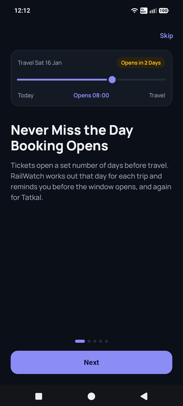
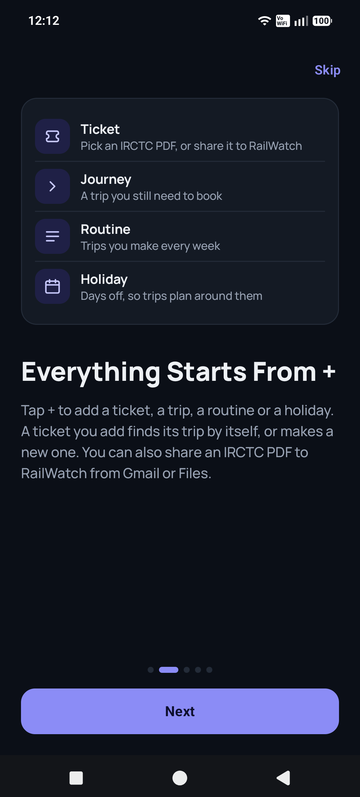
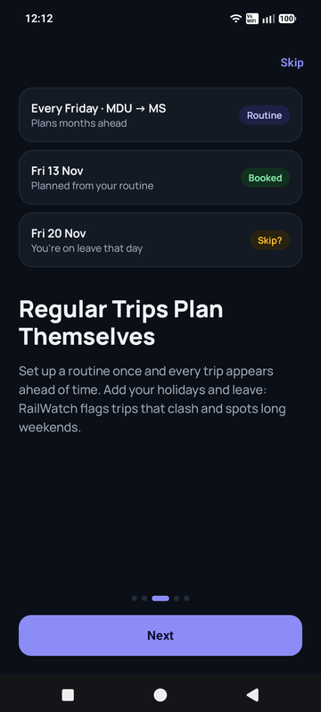
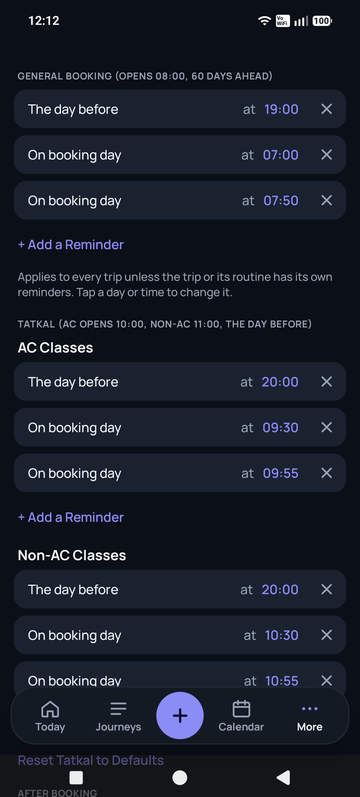
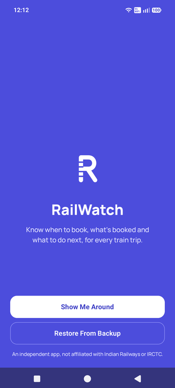
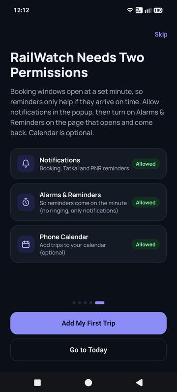
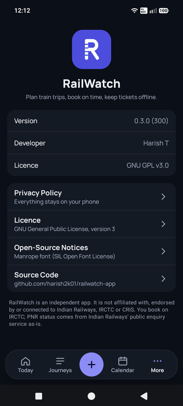

<p align="center">
  
</p>

<h1 align="center">RailWatch</h1>

<p align="center">
  <strong>Know when to book, what's booked and what to do next, for every train trip.</strong><br />
  A private, offline-first Android app for planning Indian Railways journeys.
</p>

<p align="center">
  <a href="https://github.com/harish2k01/railwatch-app/releases/latest"></a>
  <a href="https://github.com/harish2k01/railwatch-app/actions/workflows/release.yaml"></a>
  
  <a href="LICENSE"></a>
</p>

---

<p align="center">
  
  
  
  
</p>
<p align="center">
  
  
  
</p>

## Features

- **Booking windows, worked out for you.** For every trip, RailWatch knows the day and minute booking opens,
  for both general and Tatkal (AC and non-AC), and reminds you before it does.
- **Routines.** Set a regular trip once, for example every Friday from Madurai to Chennai, and RailWatch plans
  each journey months ahead.
- **Tickets.** Share an IRCTC PDF to RailWatch or pick it from Files. It reads the train, coach, berth, fare and
  PNR, links the ticket to its trip (or creates one) and keeps it available offline.
- **PNR status for every passenger.** Partly or fully cancelled tickets are flagged, and waitlisted or RAC trips
  get reminders to check again before travel.
- **Live booking countdown** on the lock screen in the last 15 minutes before a window opens.
- **Home-screen widget** showing the next thing to do: a window about to open, today's trip, trips to book.
- **Holidays and leave.** Trips that clash with time off are flagged, and long weekends are spotted.
- **Phone calendar sync**, spend tracking with charts, a notifications inbox, and a light and dark theme.
- **Backup and restore**: everything, ticket PDFs included, in one file.

## Private by design

RailWatch has no account, no server, no analytics and no ads. Your plans and tickets stay in the app's private
storage on your phone. The only network request is a PNR check you start yourself, and you type the
CAPTCHA. See the [privacy policy](PRIVACY.md).

## Install

Download the latest `RailWatch-x.y.z.apk` from
[**Releases**](https://github.com/harish2k01/railwatch-app/releases/latest), open it on your phone and allow
installing from that app when asked. Android 8.0 or newer. Installing a newer release over an older one keeps
your data. Each release lists its SHA-256 checksum.

On first launch, a short tour explains each feature and asks for the two permissions reminders need.

## Building

Requirements: JDK 17 or newer, and the Android SDK (compile SDK 37).

```bash
./gradlew :shared:jvmTest :androidApp:assembleDebug   # tests and a debug APK
./gradlew :androidApp:assemblePreview                  # optimised build, debug-signed, for testing on a phone
```

| Path | What it holds |
|---|---|
| `shared/` | Kotlin Multiplatform core: planning rules, reminders, ticket and PNR parsing, storage. JVM tests. |
| `androidApp/` | The Jetpack Compose app, notifications, widget and calendar sync. |
| `fixtures/` | Synthetic parity cases the shared rules are tested against. No real ticket data. |
| `docs/` | Screenshots for this page. |

## Releases and versioning

Every merge to `main` is released automatically by [`release.yaml`](.github/workflows/release.yaml):

1. **Version.** The merged pull request's label sets the next [semantic version](https://semver.org):
   - `major`: a breaking change (2.0.0)
   - `minor`: a new feature (1.3.0)
   - `patch`: a fix or improvement (1.2.4)
   - `skip-release`: merge without a release, for docs or CI

   Every pull request needs exactly one version label, or `skip-release` (which wins over any other); a check
   blocks merging until it has one.
2. **Build.** Tests and lint run, and an optimised release APK is built and signed with the release key, which
   is held in repository secrets.
3. **Publish.** The commit is tagged `vX.Y.Z`, and a GitHub release is published with GitHub's generated
   notes: merged pull requests grouped by label, contributors, and a full-changes link. The APK and its SHA-256
   checksum are attached.

Pull requests are checked by [`ci.yaml`](.github/workflows/ci.yaml): tests, lint, a debug APK, and the version
label.

## Contributing

1. Fork the repository and create a branch.
2. Run `./gradlew :shared:jvmTest :androidApp:lintDebug` before opening a pull request.
3. Open a pull request against `main`. A maintainer adds the version label.

Never commit real tickets, PNRs or personal data. Tests use synthetic data only.

## Roadmap

- A full accessibility pass (TalkBack and large text)
- Google Play listing
- iOS, built on the same shared core

## Disclaimer

RailWatch is an independent project. It is **not affiliated with, endorsed by or connected to Indian
Railways, IRCTC or CRIS.** You book on IRCTC. PNR status is shown as returned by Indian Railways' public
enquiry service.

## Licence

RailWatch is free software, released under the [GNU General Public License v3.0](LICENSE).
Copyright © 2026 Harish T.
The Manrope typeface is bundled under the [SIL Open Font License](MANROPE-OFL.txt).
